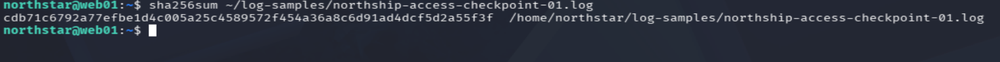
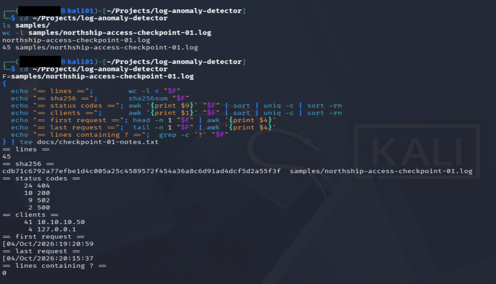
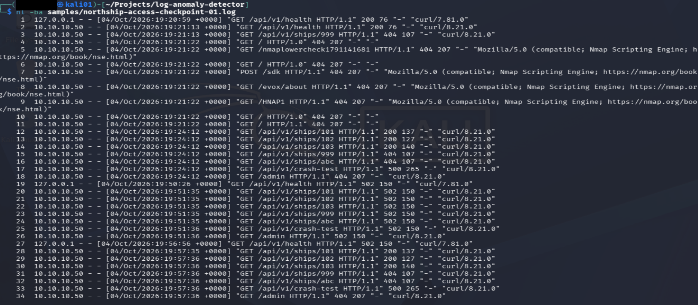
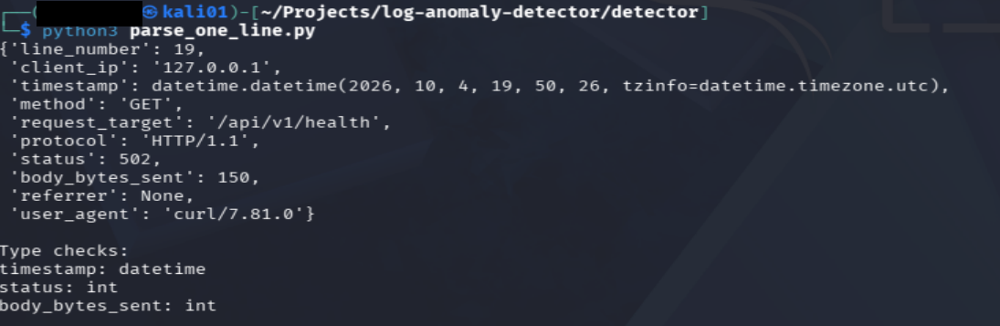
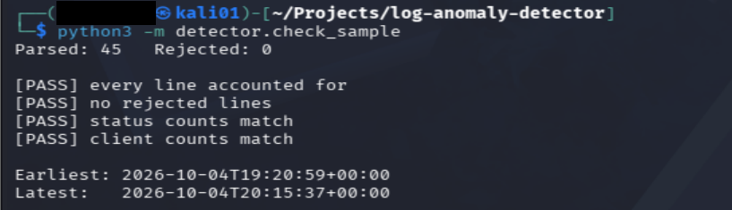
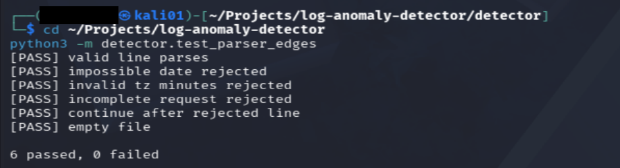
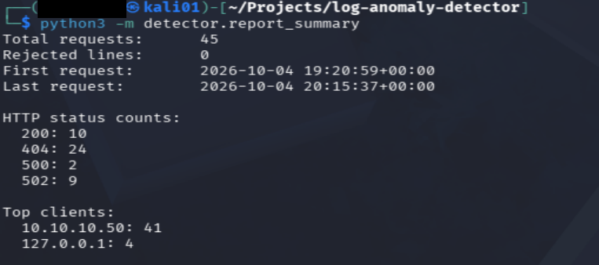
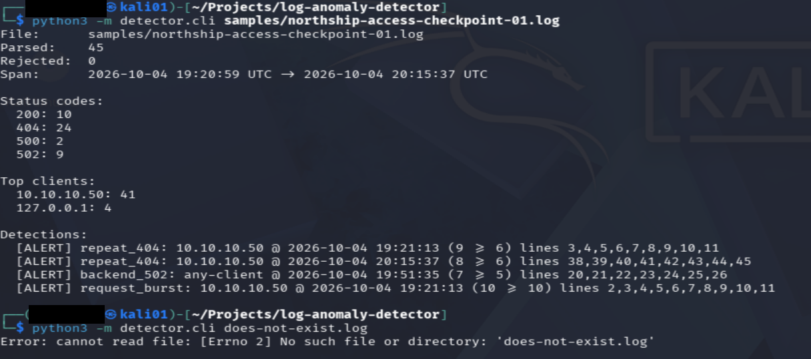

# Building a Rule-Based Nginx Log Anomaly Detector

## Summary

An offline Python command-line tool that reads an Nginx access log, summarises the traffic and raises evidence-backed alerts for three patterns: bursts of 502 responses, repeated 404s from one client, and request-volume bursts from one client. It was built and validated step by step against a preserved log sample from an isolated lab web server.

Alerts describe observed patterns. They do not claim that an attack occurred.

**What this project demonstrates**

- Turning raw log text into validated, structured records, including handling malformed input.
- Checking results against an independent reference instead of trusting the code.
- Designing detection rules with explicit thresholds and time windows, and documenting the trade-offs.
- Being clear about what the evidence can and cannot show.

## Scope: Version One

Detections: HTTP 502 spikes, repeated 404s from one client, and request bursts from one client. Window and thresholds are configurable.

**Out of scope:** SSH authentication-log analysis, machine learning, live monitoring and alert delivery, automatic IP blocking, web dashboard.

## Environment

- Ubuntu `web01` produces the Nginx access logs.
- Kali is the development and testing workspace.
- NorthShip is an isolated lab application.
- Developed on Python 3.14.6.

## How to Run

From the project root:

    python3 -m detector.cli samples/northship-access-checkpoint-01.log

Run the edge-case tests:

    python3 -m tests.test_parser_edges

## Repository Layout

    detector/
      __init__.py
      nginx_parser.py   parses log lines into structured records
      summarize.py      totals, status counts, client counts, time span
      rules.py          the three detection rules
      cli.py            single entry point producing the full report
    tests/
      test_parser_edges.py
    samples/
      northship-access-checkpoint-01.log
    docs/
      02-log-anomaly-detector.md
      images/

## Checkpoint 1: Input Preparation

A copy of the Ubuntu access log was preserved as a fixed input sample. The live log changes as requests arrive and may rotate. A fixed sample makes results repeatable and comparable.

### Preserved input

- Working sample: `samples/northship-access-checkpoint-01.log`
- Source: snapshot of the NorthShip Nginx access log on Ubuntu.
- Input line count: 45.
- The Ubuntu snapshot and the Kali working copy have matching SHA-256 hashes:

`cdb71c6792a77efbe1d4c005a25c4589572f454a36a8c6d91ad4dcf5d2a55f3f`

Matching hashes confirm the transfer preserved the exact contents. They do not establish the authenticity or completeness of the original logging.

### Reference counts (shell commands)

These were produced with shell commands before any Python was written, to act as an independent answer key. Status extraction used a whitespace field position, so they are reference values to check the parser against.

<table>
<thead><tr><th>HTTP status</th><th>Count</th></tr></thead>
<tbody>
<tr><td>200</td><td>10</td></tr>
<tr><td>404</td><td>24</td></tr>
<tr><td>500</td><td>2</td></tr>
<tr><td>502</td><td>9</td></tr>
<tr><td><strong>Total</strong></td><td><strong>45</strong></td></tr>
</tbody>
</table>

<table>
<thead><tr><th>Client address</th><th>Count</th></tr></thead>
<tbody>
<tr><td>10.10.10.50</td><td>41</td></tr>
<tr><td>127.0.0.1</td><td>4</td></tr>
<tr><td><strong>Total</strong></td><td><strong>45</strong></td></tr>
</tbody>
</table>

*Caption note: this screenshot also writes to `checkpoint-01-notes.txt`, a scratch file that is not part of the final repository.*

### Sample review and activity labels

All 45 records follow a consistent combined-style Nginx access-log structure. No credentials, tokens or personal handles were observed.

<table>
<thead><tr><th>Lines</th><th>Activity label</th><th>Evidence</th></tr></thead>
<tbody>
<tr><td>1–3</td><td>Initial API verification</td><td>Health checks and a missing ship request</td></tr>
<tr><td>4–11</td><td>First scan-associated request group</td><td>Eight 404 responses in one second; several requests identify the Nmap Scripting Engine</td></tr>
<tr><td>12–18</td><td>Controlled endpoint tests</td><td>Successful ship requests, missing resources, and a crash-test 500</td></tr>
<tr><td>19–27</td><td>Observed backend-failure responses</td><td>Nine 502 responses</td></tr>
<tr><td>28–34</td><td>Recovery verification</td><td>Successful ship requests resume; missing resources and crash test return expected errors</td></tr>
<tr><td>35–37</td><td>Later API verification</td><td>Health checks and a missing ship request</td></tr>
<tr><td>38–45</td><td>Second scan-associated request group</td><td>Eight 404 responses in one second; several requests identify the Nmap Scripting Engine</td></tr>
</tbody>
</table>

### Interpretation limits

- Activity labels combine access-log evidence with the operator's lab notes.
- User-agent values are client-supplied and do not prove which tool made a request.
- The first recorded 502 is at 19:50:26 UTC and the last at 19:56:56 UTC. A successful ship request is recorded at 19:57:35 UTC. These observations do not establish the exact outage start or end.
- The application syntax error was identified during troubleshooting. The access log alone does not reveal the root cause.
- HTTP status codes alone do not establish malicious intent, and controlled lab traffic is not representative of a production network.

## Checkpoint 2: Parser

A parser converts text into structured values. It does not decide whether activity is suspicious.

Each log line becomes one record. Using line 19 as the example:

<table>
<thead><tr><th>Field</th><th>Value from line 19</th><th>Why keep it</th></tr></thead>
<tbody>
<tr><td>line_number</td><td>19</td><td>Locate the supporting evidence</td></tr>
<tr><td>client_ip</td><td>127.0.0.1</td><td>Group requests by client</td></tr>
<tr><td>timestamp</td><td>Timezone-aware datetime</td><td>Calculate time windows</td></tr>
<tr><td>method</td><td>GET</td><td>Describe the request</td></tr>
<tr><td>request_target</td><td>/api/v1/health</td><td>Preserve what was requested</td></tr>
<tr><td>protocol</td><td>HTTP/1.1</td><td>Preserve request details</td></tr>
<tr><td>status</td><td>Integer 502</td><td>Count and filter responses</td></tr>
<tr><td>body_bytes_sent</td><td>Integer 150</td><td>Summarise response sizes</td></tr>
<tr><td>referrer</td><td>None (missing)</td><td>Preserve context when present</td></tr>
<tr><td>user_agent</td><td>curl/7.81.0</td><td>Provide investigative context</td></tr>
</tbody>
</table>

These field names are this project's own design, not an existing standard.

### Development iteration: one record

The first exercise parsed only line 19 to understand extraction and type conversion (a regex recognises the outer structure, then fields are validated and converted). The script was a learning step and was later removed from the repository.

### Full-sample validation

A validator script compared the parser's output with the Checkpoint 1 reference counts. It was also removed once the tests and CLI replaced it.

- Parsed: 45. Rejected: 0.
- Line accounting, no rejections, status counts and client counts: all PASS.
- Earliest timestamp: 2026-10-04T19:20:59+00:00. Latest: 2026-10-04T20:15:37+00:00.

### Edge-case tests

Passing on a clean sample does not show robustness, so a test suite covers bad input. One test exposed a real defect: invalid timezone offsets such as `+0060` were accepted until minute validation was added.

<table>
<thead><tr><th>Test</th><th>Protects against</th></tr></thead>
<tbody>
<tr><td>valid line parses</td><td>Regression on normal input</td></tr>
<tr><td>impossible date rejected</td><td>Dates that do not exist</td></tr>
<tr><td>invalid tz minutes rejected</td><td>Offsets such as `+0060`</td></tr>
<tr><td>incomplete request rejected</td><td>Truncated request fields</td></tr>
<tr><td>continue after rejected line</td><td>One bad line stopping the whole file</td></tr>
<tr><td>empty file</td><td>A crash on files with no records</td></tr>
</tbody>
</table>

Result: **6 passed, 0 failed**. Rejected lines are kept with their line number and reason instead of being discarded.

*Caption note: captured before the tests moved to `tests/`. The current command is `python3 -m tests.test_parser_edges`.*

## Checkpoint 3: Summaries

A summary module reports total requests, status counts, client counts, the time span and the number of rejected lines. For an empty file it returns no times instead of crashing.

The output matches the Checkpoint 1 reference values.

## Checkpoint 4: Detection Rules

Each rule slides a time window over the records and raises an alert when a count reaches its threshold. Every alert includes the client (where relevant), window start, count, threshold and the exact log line numbers as evidence.

<table>
<thead><tr><th>Rule</th><th>Question</th><th>Window</th><th>Threshold</th></tr></thead>
<tbody>
<tr><td><code>repeat_404</code></td><td>Did one client receive many 404s?</td><td>10 s</td><td>6 or more per client</td></tr>
<tr><td><code>backend_502</code></td><td>Did many 502s occur, across any client?</td><td>10 s</td><td>5 or more</td></tr>
<tr><td><code>request_burst</code></td><td>Did one client send many requests?</td><td>10 s</td><td>10 or more per client</td></tr>
</tbody>
</table>

Defaults were chosen for a small lab and have not been tuned against production traffic.

### Design decisions

- **`repeat_404` counts any 404 per client, not only repeats of one path.** A scanner such as Nmap probes many different paths, so a same-path rule would miss it.
- **Report all windows, not just the first.** The first version stopped after one alert per client and hid the second scan at 20:15:37. It now continues scanning and skips past each alerted window, so every distinct wave is reported without duplicate alerts for the same burst.

### Detections on the preserved sample

<table>
<thead><tr><th>Rule</th><th>Client</th><th>Window start (UTC)</th><th>Count / threshold</th><th>Evidence lines</th><th>Matches operator notes</th></tr></thead>
<tbody>
<tr><td><code>repeat_404</code></td><td>10.10.10.50</td><td>2026-10-04 19:21:13</td><td>9 / 6</td><td>3–11</td><td>First scan group</td></tr>
<tr><td><code>repeat_404</code></td><td>10.10.10.50</td><td>2026-10-04 20:15:37</td><td>8 / 6</td><td>38–45</td><td>Second scan group</td></tr>
<tr><td><code>backend_502</code></td><td>any</td><td>2026-10-04 19:51:35</td><td>7 / 5</td><td>20–26</td><td>Backend-failure period</td></tr>
<tr><td><code>request_burst</code></td><td>10.10.10.50</td><td>2026-10-04 19:21:13</td><td>10 / 10</td><td>2–11</td><td>Dominated by the first scan</td></tr>
</tbody>
</table>

The isolated 502s at 19:50:26 and 19:56:56 did not trigger an alert because a single response is below the threshold.

## Checkpoint 5: Command-Line Interface

`detector/cli.py` combines parsing, summary and rules into one command. It prints a usage message for wrong arguments (exit code 2) and a clear error for unreadable files (exit code 1) instead of a traceback.

    python3 -m detector.cli samples/northship-access-checkpoint-01.log

## Limitations

- Validated on one 45-line lab sample. Detections were compared with the operator's own notes, not with independent ground truth. False positives and false negatives on other traffic have not been measured.
- Thresholds are defaults for a small lab. For example, `request_burst` fired at exactly 10 of 10.
- Windows are half-open and start at an event. Ten requests spanning exactly 10.0 seconds, as around 20:15:27 to 20:15:37, do not trigger `request_burst`. A burst that straddles a window boundary can also be split.
- Only the Nginx access-log format is supported. Log rotation, compressed logs and live tailing are not handled.
- Alerts are evidence for investigation, not proof of malicious intent.